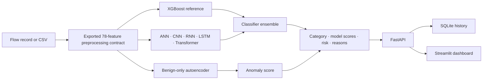

# IMB

**A deep-learning network threat detection project for offline flow records and
authorized lab data.**

IMB turns network-flow features into model predictions, anomaly signals, and
explainable risk summaries. It combines a PyTorch model suite with an XGBoost
reference, exposes inference through FastAPI, and presents results in a
Streamlit dashboard.

> **Safety and scope:** IMB analyzes supplied flow records. It does not capture
> traffic automatically or block, quarantine, or modify network traffic.


## What it does

- Accepts fixed-width network-flow records and CSV files.
- Applies the exact ordered feature and scaling contract exported with the
  trained models.
- Scores flows with XGBoost and five PyTorch classifiers: ANN, CNN, RNN, LSTM,
  and Transformer.
- Adds an autoencoder reconstruction-error signal and configurable risk score.
- Stores detection summaries in SQLite while limiting persisted flow metadata.
- Shows fleet-level trends, recent alerts, and per-model votes in the dashboard.

## Model architecture



The preprocessing artifact defines the feature names, feature order, median
imputation values, and scaling parameters. The application loads that artifact
directly; it does not fit a replacement preprocessor during inference. The
classifier ensemble weights and risk thresholds are in `config.yaml`.

The CNN preserves feature-axis positions. The recurrent and attention models
consume ordered feature indices as tokens. **CIC-IDS-2017 flow CSVs are not
time-series sequences**, so these RNN/LSTM/Transformer inputs do not represent
chronological packets or flows.

## Current benchmark

These are the values in the current exported evaluation artifact. Accuracy and
Macro-F1 are reported as measured; they are not guarantees of correctness.

| Model | Family | Accuracy | Macro-F1 |
|---|---|---:|---:|
| XGBoost | Gradient-boosted trees | 98.21% | 93.15% |
| CNN | Deep learning | 95.72% | 81.32% |
| ANN | Deep learning | 92.59% | 77.64% |
| LSTM | Deep learning | 91.42% | 74.88% |
| RNN | Deep learning | 89.33% | 72.37% |
| Transformer | Deep learning | 84.17% | 66.30% |
| Autoencoder | Anomaly detection | 24.63% | 24.42% |

The classifier scores use a stratified random holdout from the same dataset.
They do **not** establish performance on a different capture, day, network, or
deployment. Correlated or duplicate flows can make random-split results
optimistic. The current autoencoder result is weak and should be treated as
experimental, not as a reliable standalone detector.

## Quick start — Windows PowerShell

The product is branded **IMB**; the local project folder remains `AEGIS-NET`.
From its parent directory, run:

```powershell
cd .\AEGIS-NET
py -3.15 -m venv .venv
.\.venv\Scripts\Activate.ps1
python -m pip install --upgrade pip
python -m pip install -r requirements.txt
```

Check which PyTorch device is actually available:

```powershell
python -c "import torch; print('PyTorch:', torch.__version__); print('CUDA runtime:', torch.version.cuda); print('CUDA available:', torch.cuda.is_available()); print('GPU:', torch.cuda.get_device_name(0) if torch.cuda.is_available() else 'unavailable')"
```

### Train the models

The training command downloads the public CIC-IDS-2017 flow dataset through
KaggleHub. To use an already extracted dataset, pass its directory with
`--dataset-dir`.

```powershell
python -m imb.models.train_models --device cpu --xgboost-device cuda --overwrite-artifacts
```

The training pipeline uses a shared fitted preprocessing contract and exports
the classifier, five neural models, autoencoder, labels, thresholds, metrics,
and feature order to `artifacts\`. **`--overwrite-artifacts` replaces the
existing model bundle.**

On this machine, the NVIDIA RTX 3050 and driver are visible, but PyTorch CUDA
is not currently usable: Windows Application Control blocked
`torch\lib\c10.dll` with WinError 4551. The current environment therefore uses
CPU PyTorch. The official Python 3.15/CUDA 13 wheel is pinned in
`requirements-cuda.txt`; an administrator must review and permit it through the
device's approved application-control policy. Do not disable or bypass that
policy. After approval, install and verify the CUDA build:

```powershell
python -m pip install -r requirements-cuda.txt
python -c "import torch; print(torch.__version__, torch.version.cuda); print(torch.cuda.is_available()); print(torch.cuda.get_device_name(0) if torch.cuda.is_available() else 'CUDA unavailable')"
```

Only when the final check reports CUDA available should PyTorch training use
`--device cuda`. The XGBoost device is configured separately.

### Run the API and dashboard

Start the backend in one PowerShell terminal:

```powershell
.\.venv\Scripts\python.exe -m uvicorn api.main:app --host 127.0.0.1 --port 8000
```

Start the dashboard in another:

```powershell
.\.venv\Scripts\python.exe -m streamlit run dashboard/app.py
```

Open the Streamlit URL printed in the terminal (normally
`http://localhost:8501`). The API defaults to `http://127.0.0.1:8000`; its
interactive documentation is at `http://127.0.0.1:8000/docs`.

| Endpoint | Purpose |
|---|---|
| `GET /health` | Service and model readiness |
| `POST /predict` | Predict one flow; include all required feature names |
| `POST /analyze-file` | Analyze a CSV with the required model features |
| `GET /alerts` | Page through suspicious detections |
| `GET /metrics` | Local detection counts and exported evaluation metrics |

CSV uploads are limited to 20 MiB and 10,000 rows by default; adjust
`api.max_upload_bytes` and `api.max_csv_rows` in `config.yaml` if needed.
SQLite stores detection results and only an allowlist of flow metadata
(destination port, flow duration, packet rate, and byte rate), not full
uploaded rows. Keep the service bound to localhost unless a network-facing
deployment has been deliberately secured.

## Validate

```powershell
.\.venv\Scripts\python.exe -m pytest -q
```

The tests cover preprocessing, model construction, batch prediction, API
validation, CSV analysis, and SQLite persistence.

## Project structure

```text
AEGIS-NET/
├── api/                 # FastAPI app, routes, and request/response schemas
├── artifacts/           # Exported models, preprocessing, labels, and metrics
├── dashboard/           # Streamlit operations and deep-learning views
├── data/                # Raw, processed, and sample flow data
├── database/            # SQLite detection history
├── imb/                 # Training, preprocessing, models, and detection engine
├── notebooks/            # Experiments
├── tests/                # Unit and API tests
├── config.yaml
├── requirements.txt
└── requirements-cuda.txt
```

Raw datasets, trained model files, local databases, virtual environments, and
credentials are excluded from Git by default. Review the dataset's terms and
remove sensitive information before adding any sample data.

## Next validation priorities

Before operational use, evaluate with capture/day-separated data, review
per-class precision and recall, calibrate risk thresholds against false-positive
requirements, and improve anomaly detection. The current random-split metrics
are development benchmarks—not deployment claims.
